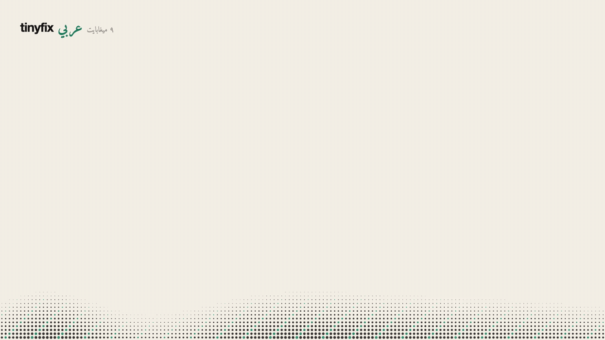

# tinyfix-ar

A 9 MB model that runs in your browser and fixes Arabic spelling mistakes spell checkers miss, because the mistake is a real word or a common misspelling.



Full video: [tinyfix-ar-demo.mp4](https://github.com/y0u-0/tinyfix-ar/releases/download/v1.0.0/tinyfix-ar-demo.mp4). Built as an Arabic take on [paperweight/tinyfix](https://huggingface.co/paperweight/tinyfix), the 2.1 MB English model.

## What it fixes

- Hamza: `الى` → `إلى`, `ان` → `أن` or `إن`
- Taa marbuta and haa (`ة` vs `ه`): `المدرسه` → `المدرسة`, `كتابة`/`كتابه`
- Alif maqsura and yaa (`ى` vs `ي`): `على`/`علي`, `فى` → `في`
- Dad and zaa (`ض` vs `ظ`): `الرياظ` → `الرياض`, `ظل`/`ضل`
- Common typos: `لاكن` → `لكن`, `ذالك` → `ذلك`, `فقد`/`فقط`

It leaves Saudi dialect words alone (`مره`, `ابغى`, `اروح`).

## Try it

Open [tinyfix.dahaleez.ai](https://tinyfix.dahaleez.ai) and type. The model runs in your browser, so your text never leaves it.

## Use it

```sh
npm install tinyfix-ar
```

```ts
import { loadTinyfixAr } from "tinyfix-ar";

const tinyfix = await loadTinyfixAr();
const { text, changes } = await tinyfix.fix("ذهبت الى المدرسه في الرياظ");
// text: "ذهبت إلى المدرسة في الرياض"
```

The package downloads the model from [Hugging Face](https://huggingface.co/ali77a/tinyfix-ar) the first time. See [web/README.md](web/README.md) for the API and options.

## Repo

| Folder | What's in it |
|---|---|
| [model/](model/) | The shipped model and word tables, and the Hugging Face model card |
| [web/](web/) | The `tinyfix-ar` npm package: TypeScript engine on ONNX Runtime Web |
| [app/](app/) | The live editor. `node app/build.mjs`, then `wrangler deploy --config app/wrangler.jsonc` |
| [src/tinyfix_ar/](src/tinyfix_ar/) | The Python pipeline: corpus, lexicon, training, calibration, export |
| [data/](data/) | Curated confusion lists, dialect words, training sentences and test sets |
